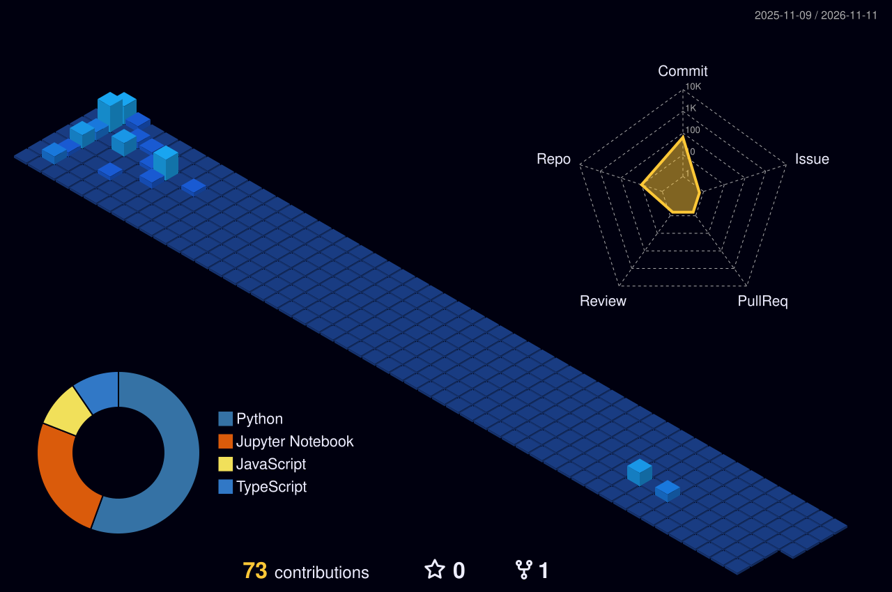

# Radithya Fawwaz Aydin

 

## About

Information Technology graduate from Universitas Brawijaya, currently working as an **AI Application Developer at Tower Bersama Group**. I build end-to-end solutions across artificial intelligence, machine learning, robotic process automation, and web development, from Hybrid RAG architectures and LLM deployment to automated workflows and API integrations.

My recent work focuses on bringing Python-based models into .NET / C# enterprise systems through FastAPI and ONNX, and on building LLM-powered web applications.

## Stack

  

Also: LangChain · Neo4j · Hugging Face · Gemini API · ONNX · OpenRPA · SQL · Pandas · NumPy · Google Apps Script

## Selected Work

<table>
<tr>
<td width="50%" valign="top">

**[LexGuard AI](https://github.com/wingscode123/tnc-risk-extractor)** 
TypeScript · React · Express · Gemini

Legal document analyzer that surfaces hidden risks and unfair clauses in terms of service, privacy policies, and contracts.

</td>
<td width="50%" valign="top">

**[Hybrid RAG System](https://github.com/wingscode123/skripsi-rag-hotpotqa)** 
Python · LangChain · Neo4j · Vector DB

Undergraduate thesis. An LLM pipeline combining knowledge graphs and vector databases to reduce hallucinations, evaluated with RAGAS on multi-hop QA.

</td>
</tr>
<tr>
<td width="50%" valign="top">

**[SubTrack](https://github.com/wingscode123/SubTrack-saas-tracker)** 
TypeScript · React · Recharts · Gemini

Subscription and SaaS spend tracker with spending charts and AI-assisted insights.

</td>
<td width="50%" valign="top">

**[AI Dungeon Master](https://github.com/wingscode123/ai-dungeon-master)** 
TypeScript · React · Gemini

Text-based RPG driven by Gemini, with strict world-building rules and simulated function calling for dice rolls and inventory.

</td>
</tr>
</table>

## Activity

  

  
  

  <picture>
    <source media="(prefers-color-scheme: dark)" srcset="https://raw.githubusercontent.com/wingscode123/wingscode123/output/github-snake-dark.svg" />
    <source media="(prefers-color-scheme: light)" srcset="https://raw.githubusercontent.com/wingscode123/wingscode123/output/github-snake.svg" />
    
  </picture>

