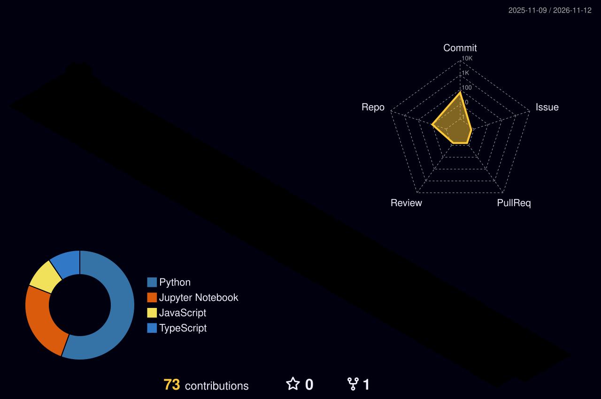

# Hi there, I'm Radithya Fawwaz Aydin 👋

## 💫 About Me

Information Technology graduate from **Universitas Brawijaya** (GPA 3.81 / 4.00) with a full-stack skill set spanning **Artificial Intelligence, Machine Learning, Robotic Process Automation (RPA), and web development**. I build end-to-end solutions, from Hybrid RAG architectures and LLM deployment to automated operational workflows and API integrations.

- 💼 Currently an **AI Application Developer** at **Tower Bersama Group**
- 🧠 Thesis: *Hybrid RAG System: Integrating Knowledge Graphs and Vector Databases for Contextual Accuracy*
- ⚙️ Bridging Python ML models with **.NET / C#** enterprise apps via FastAPI and ONNX
- 🤖 Building AI-powered web apps with React, TypeScript, and the Gemini API
- 🌏 Languages: Indonesian (native), English (professional working proficiency)

## 💼 Experience

| Role | Organization | Period |
|---|---|---|
| **AI Application Developer** | Tower Bersama Group | Jul 2026 – Present |
| **AI/ML Engineer Intern** | Tower Bersama Group | Jan 2026 – Jun 2026 |
| **IT Project Manager** | PT. FSCM Manufacturing Indonesia | Feb 2025 – Aug 2025 |
| **Machine Learning Engineer Cohort** | Coding Camp powered by DBS Foundation | Feb 2025 – Jul 2025 |
| **Project-Based Virtual Intern: Data Scientist** | ID/X Partners × Rakamin Academy | Jan 2025 – Feb 2025 |

<b>Highlights</b>

 

- **Tower Bersama Group:** connected Python ML models to .NET/C# systems using FastAPI wrappers and ONNX, built RPA workflows with OpenRPA, and integrated custom AI assistants into internal web apps.
- **PT. FSCM Manufacturing Indonesia:** launched a 24/7 warehouse booking system with Google Apps Script and Google Cloud API, improving supplier scheduling efficiency by **50%**.
- **DBS Foundation Coding Camp:** led the capstone *We're Cooked* (hybrid recipe recommender, final score **>95/100**) and deployed the model to the Hugging Face API.
- **ID/X Partners:** built deep learning models for credit risk prediction with **>90% accuracy**.

## 🛠️ Tech Stack

   
   
  

  
  
  
  
  
  
  
  
  
  
  
  

## 🚀 Latest Projects

<table>
<tr>
<td width="50%" valign="top">

### ⚖️ [LexGuard AI — T&C Risk Extractor](https://github.com/wingscode123/tnc-risk-extractor)
AI legal document analyzer that finds hidden risks and unfair clauses in Terms & Conditions, privacy policies, and contracts. Results come back as risk cards (High / Medium / Low) with exportable JSON.

   

</td>
<td width="50%" valign="top">

### 💳 [SubTrack — SaaS Spend Tracker](https://github.com/wingscode123/SubTrack-saas-tracker)
Track subscriptions and SaaS spending in one dashboard, with spend charts and AI-assisted insights.

   

</td>
</tr>
<tr>
<td width="50%" valign="top">

### 🐉 [AI Dungeon Master](https://github.com/wingscode123/ai-dungeon-master)
Interactive text-based RPG driven by Gemini, with strict world-building rules and simulated function calling for dice rolls and inventory.

  

</td>
<td width="50%" valign="top">

### 🧠 [Hybrid RAG System (Thesis)](https://github.com/wingscode123/skripsi-rag-hotpotqa)
LLM pipeline that combines Knowledge Graphs and Vector Databases to reduce hallucinations and improve context retrieval, evaluated with RAGAS metrics on multi-hop QA (HotpotQA).

   

</td>
</tr>
</table>

<b>📁 More projects</b>

 

| Project | Description |
|---|---|
| 🍳 We're Cooked (DBS capstone) | Hybrid recipe recommender (content-based + collaborative) served through the Hugging Face API to a React app |
| [⚽ Football Analysis & AI Summary](https://github.com/wingscode123/ibm-skillsbuild-football-analysis-2024-2025) | 2024/2025 European match analysis with automated summaries from IBM Granite LLM (Replicate API) |
| [🧑‍🎓 Student Depression Prediction](https://github.com/wingscode123/studepression_predictive-analytic) | Early depression-risk classifier with **89% recall** and **0.92 AUC-ROC** |
| [🎥 Movie RecSys (TMDB 5000)](https://github.com/wingscode123/movies_recsys_tmdb5000) | Content-based recommender using TF-IDF and cosine similarity |
| [🎙️ Speech Emotion Recognition](https://github.com/wingscode123/speech-emotions-recognition-project) | Classifying emotions from speech audio |
| [📰 Fake News Detection](https://github.com/wingscode123/detecting-fake-news-projects) | NLP model to detect fake news articles |
| [🩺 Breast Cancer Classification](https://github.com/wingscode123/breast-cancer-classification-project) | ML classifier for breast cancer diagnosis |
| [⚙️ Workflow CI (MLflow)](https://github.com/wingscode123/Workflow-CI) | ML training pipeline with MLflow and GitHub Actions |
| [🔏 EdDSA Digital Signature](https://github.com/wingscode123/Sistem-Autentikasi-Tanda-Tangan-Digital-EdDSA-SHA-512-Kriptografi) | Digital signature authentication with EdDSA + SHA-512 |

## 🏅 Awards & Certifications

| Award | Year |
|---|---|
| 🥈 **2nd Winner Best Project** — Top 15 & Semifinalist, Enterns UI | 2024 |
| 🏛️ **Best Ministry of The Year** — BEM FILKOM UB, Kementerian Ekonomi Kreatif | 2024 |
| 💡 **P2MW & PMW UB Recipient** — Creative Industry, Arts & Culture category | 2024 |
| 📈 **Top 10 Business Plan Competition** — Brawijaya Business and Career | 2023 |
| 🥈 **2nd Place, Entrepreneurship** — Dekan Cup FILKOM UB | 2022 |

**Certifications:** Data Classification and Summarization Using IBM Granite (IBM, 2025) · Membangun Sistem Machine Learning (Dicoding, 2025) · Belajar Pengembangan Machine Learning (Dicoding, 2025) · Fullstack Data Analysis Intensive Bootcamp (MySkill, 2024)

## 📊 GitHub Stats

  

  

  

## 🏆 GitHub Achievements

  

  <picture>
    <source media="(prefers-color-scheme: dark)" srcset="https://raw.githubusercontent.com/wingscode123/wingscode123/output/github-snake-dark.svg" />
    <source media="(prefers-color-scheme: light)" srcset="https://raw.githubusercontent.com/wingscode123/wingscode123/output/github-snake.svg" />
    
  </picture>

